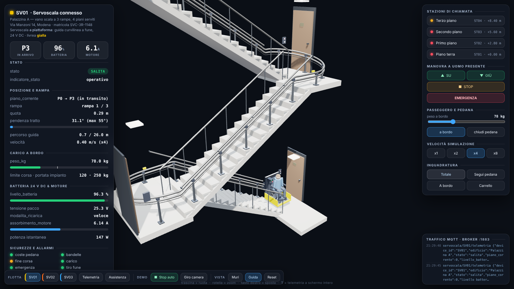
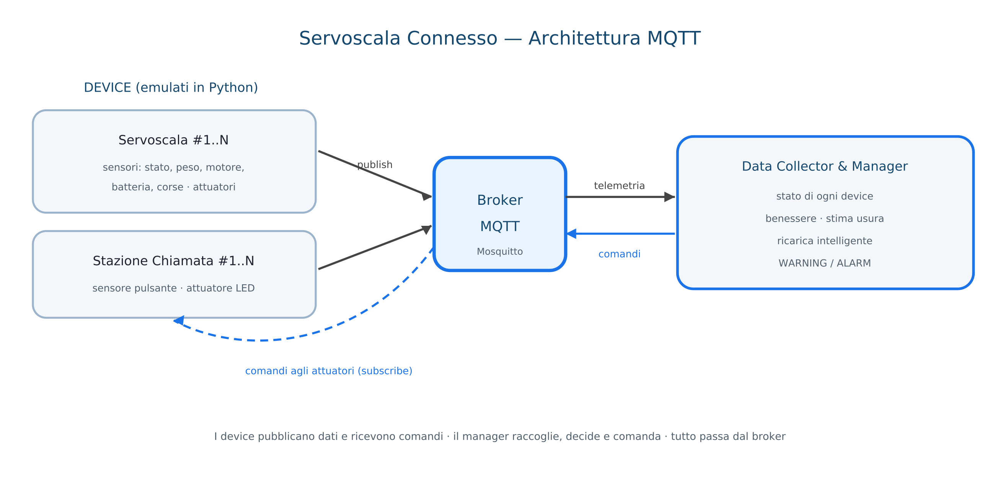
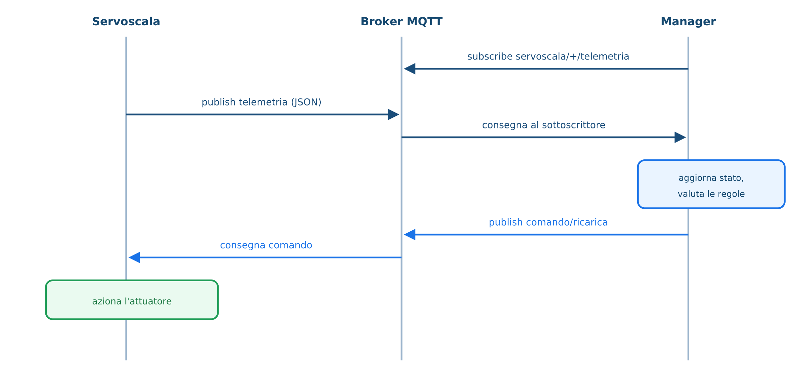
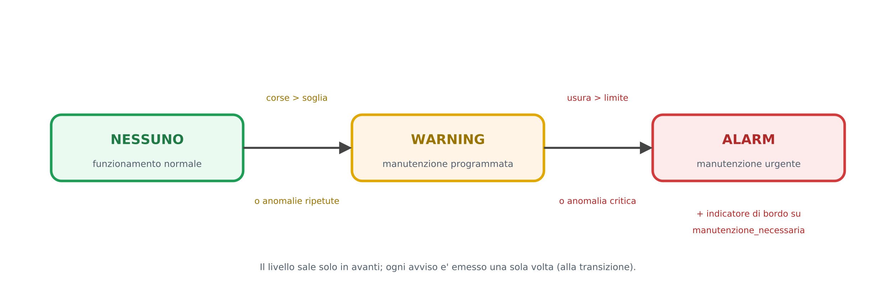
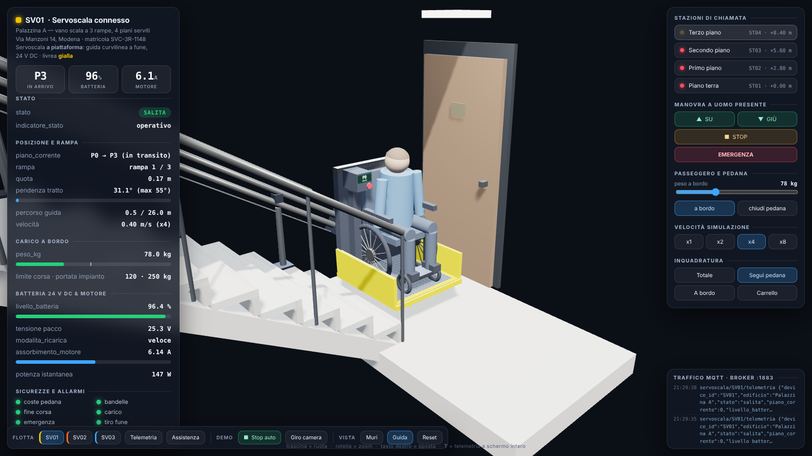
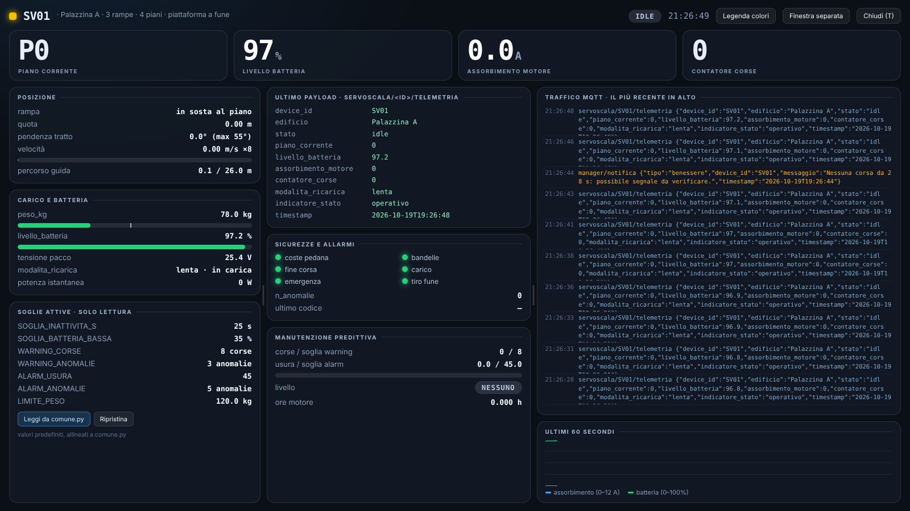
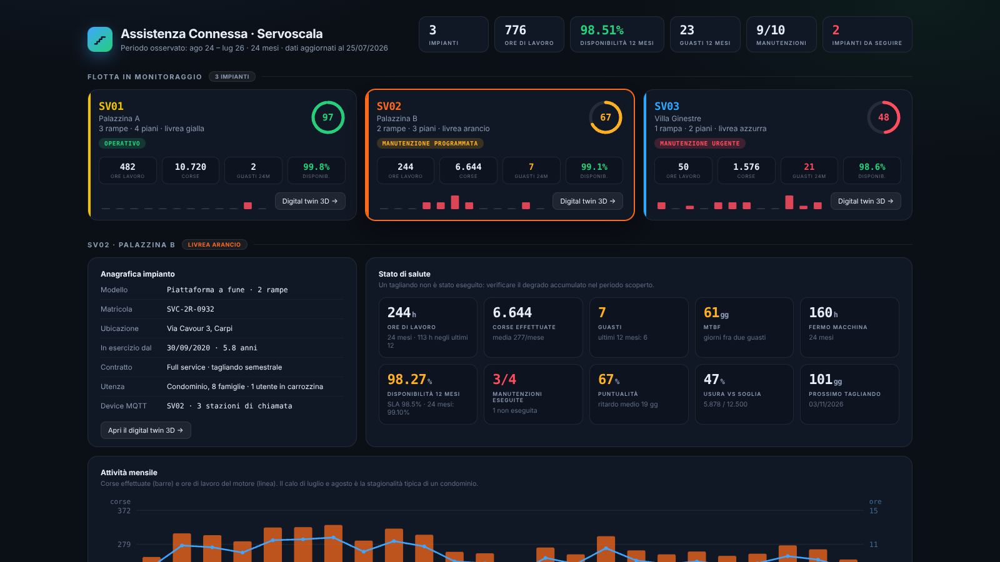
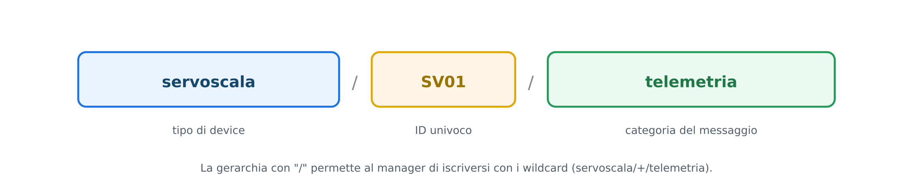

# Connected Stairlift — IoT Monitoring System

**Remote monitoring of a fleet of platform stairlifts over MQTT: user well-being alerts,
predictive maintenance and interactive 3D digital twins.**


<p align="center">
  
</p>

<p align="center">
  <a href="https://brighentialex.github.io/connected-stairlift-iot/demo3d/impianto_SV01_3rampe.html"><b>▶ Open the 3D digital twin</b></a>
  &nbsp;·&nbsp;
  <a href="https://brighentialex.github.io/connected-stairlift-iot/demo3d/assistenza_flotta.html"><b>▶ Open the fleet service portal</b></a>
  &nbsp;·&nbsp;
  <a href="https://brighentialex.github.io/connected-stairlift-iot/demo3d/documentario_SV01.html"><b>▶ Watch the 2-minute walkthrough</b></a>
</p>
<p align="center"><sub>The demos run in the browser, nothing to install.</sub></p>

IoT system for the **remote monitoring of a fleet of stairlifts** (the platform lifts
that help people with reduced mobility overcome architectural barriers), designed to
support **user well-being** and **predictive maintenance**. Emulated smart devices and
floor call stations publish telemetry to an MQTT broker; a central manager keeps the
state of every device, applies five rules and drives the devices' actuators.

Project for the course **"Intelligent Internet of Things"**, Bachelor's Degree in
**Computer Engineering**, UNIMORE (Mantova campus).

> Code identifiers, comments and the study guide are in Italian; this README is in English.

### Highlights

- **Hub-and-spoke MQTT architecture**: devices never talk to each other, everything goes through the broker.
- **Scales to _n_ devices with zero code changes**, thanks to single-level topic wildcards (`servoscala/+/telemetria`).
- **Five rules** in the manager: well-being (inactivity), wear estimation, smart charging, scheduled and urgent maintenance.
- **QoS chosen per message type**: 0 for the continuous telemetry stream, 1 for rides, events, commands and alerts.
- **Interactive 3D digital twins** that publish exactly the same payloads, on the same topics, as the Python devices.

---

## Table of Contents

- [Architecture & Main Components](#architecture--main-components)
- [System Features](#system-features)
- [Interactive 3D Digital Twins](#interactive-3d-digital-twins)
- [Data Models](#data-models)
- [Protocols & Communication](#protocols--communication)
- [Project Structure](#project-structure)
- [How to Run](#how-to-run)
- [Documentation](#documentation)

---

## Architecture & Main Components



The system follows a hub-and-spoke IoT architecture where an **MQTT broker** mediates
all asynchronous communication. Devices publish data and subscribe to their own command
topics; the manager subscribes to every device through wildcards and publishes commands
back.

- **Edge Layer (IoT devices, emulated in Python)**
  - **Stairlift Smart Object**: one per stairlift, identified by a unique ID and a
    location (building and position).
    - *Sensors*: operating state & current floor (idle, up, down, out of service);
      platform load; motor current draw; battery level; ride counter; diagnostic
      events (emergency, overload, error code).
    - *Actuators*: on-board status indicator (operational / maintenance needed);
      battery charging mode (slow / fast).
  - **Floor Call Station**: installed at a served floor, identified by an ID and a
    reference floor.
    - *Sensor*: call button.
    - *Actuator*: multicolor status LED (free, arriving, busy).

- **Backend Layer**
  - **Data Collector & Manager**: the "brain" of the system. It keeps an up-to-date
    state for every device, applies the rules below and issues commands to the actuators.

- **Application Layer**
  - **Terminal Dashboard**: a textual real-time view of every device's state.
  - **Notification Listener**: a dedicated view for well-being and maintenance alerts.

One message round trip, from telemetry to actuator:



---

## System Features

### 1. Well-being notification (inactivity)
If a stairlift performs no rides for longer than a configurable threshold, the manager
emits a well-being notification, once. In a private home this is a useful signal for
relatives: a lift used every day that suddenly stops may mean the person needs help.

### 2. Wear estimation (weight ↔ motor current)
Every ride report carries the transported weight and the average motor current, which
grows with the weight. The manager accumulates the current of every ride into a
wear estimate for that device.

### 3. Smart battery charging
The manager sets the charging mode: **fast** during periods of use (or when the battery
is low) to keep the lift ready, **slow** otherwise to preserve the battery. In the demo,
recent activity stands in for the usage time-slots a real system would learn from history.

### 4. Scheduled maintenance (WARNING)
When the ride counter exceeds a threshold, or anomalies start repeating, the manager
raises a scheduled-maintenance warning.

### 5. Urgent maintenance (ALARM)
When the estimated wear exceeds its limit, or anomalies keep piling up, the manager
raises an urgent-maintenance alert **and** switches the on-board indicator to
*maintenance needed*. Taking the device out of service remains the technician's job.

The maintenance level only moves forward, and each alert is sent once, on the transition:



---

## Interactive 3D Digital Twins

The [`demo3d/`](demo3d/) folder contains self-contained web pages (Three.js) that bring
the system to life. A condominium stairwell with a curved-rail, rope-driven platform
stairlift is generated from the number of flights; you can call the lift from any floor,
drive it manually, change the load on board and watch the MQTT messages it produces.

The twins **do not invent a data model**: they publish exactly the payloads of
`servoscala.py` and `stazione_chiamata.py`, on the same topics, and apply the same rules
and thresholds as `manager.py` and `comune.py`.

<table>
  <tr>
    <td width="50%"></td>
    <td width="50%"></td>
  </tr>
  <tr>
    <td><sub><b>Digital twin</b>: the platform climbing, with live state, battery and motor current.</sub></td>
    <td><sub><b>Telemetry view</b> (key <code>T</code>): last payload field by field, active thresholds, MQTT traffic with a well-being alert.</sub></td>
  </tr>
  <tr>
    <td colspan="2"></td>
  </tr>
  <tr>
    <td colspan="2"><sub><b>Fleet service portal</b>: what a maintenance service can offer once lifts are connected. 24 months of history per lift, failures by code, MTBF, availability against the SLA, planned vs performed maintenance.</sub></td>
  </tr>
</table>

| Page | What it shows |
| --- | --- |
| [`impianto_SV01_3rampe.html`](demo3d/impianto_SV01_3rampe.html) | Building A: 3 flights, 4 floors |
| [`impianto_SV02_2rampe.html`](demo3d/impianto_SV02_2rampe.html) | Building B: 2 flights, 3 floors |
| [`impianto_SV03_1rampa.html`](demo3d/impianto_SV03_1rampa.html) | Detached house: 1 flight, 2 floors |
| [`assistenza_flotta.html`](demo3d/assistenza_flotta.html) | Fleet service portal for the three twins |
| [`documentario_SV01.html`](demo3d/documentario_SV01.html) | Scripted 2′41″ walkthrough that freezes on every key MQTT message; can be recorded to video with one click |

Details (in Italian) in [`demo3d/README.md`](demo3d/README.md).

---

## Data Models

All data is exchanged as **JSON** payloads. Every message carries at least a
`device_id` and an ISO-8601 `timestamp`.

**Stairlift telemetry**

| Field | Type | Description |
| --- | --- | --- |
| `device_id` | String | Unique device identifier |
| `edificio` | String | Building / location |
| `stato` | String | `idle` / `salita` / `discesa` / `fuori_servizio` |
| `piano_corrente` | Integer | Current floor |
| `livello_batteria` | Number | Battery level (0–100%) |
| `assorbimento_motore` | Number | Motor current draw (A) |
| `contatore_corse` | Integer | Total rides performed |
| `modalita_ricarica` | String | `lenta` / `veloce` |
| `indicatore_stato` | String | `operativo` / `manutenzione_necessaria` |

**Ride report**

| Field | Type | Description |
| --- | --- | --- |
| `peso_kg` | Number | Transported weight (kg) |
| `assorbimento_medio` | Number | Average motor current during the ride (A) |
| `piano_partenza` / `piano_arrivo` | Integer | Start / end floor |
| `durata_s` | Number | Ride duration (s) |

**Diagnostic event / Call button / Command**

| Message | Key fields |
| --- | --- |
| Event | `tipo` (`emergenza`/`sovraccarico`/`errore`), `codice_errore`, `descrizione` |
| Button | `piano`, `premuto` |
| Command | `valore` (e.g. `veloce`, `manutenzione_necessaria`, `in_arrivo`) |

---

## Protocols & Communication

MQTT is used for its lightweight, asynchronous, publish/subscribe nature. The broker is
**Eclipse Mosquitto**; clients use the Python **paho-mqtt** library. Topics follow the
convention `device_type / device_id / category [ / detail ]`:



### MQTT Topics & Service Mapping

| Topic pattern | Purpose | Publisher | Subscriber |
| --- | --- | --- | --- |
| `servoscala/<id>/telemetria` | Periodic device state | Stairlift | Manager |
| `servoscala/<id>/corsa` | Ride report (weight + current) | Stairlift | Manager |
| `servoscala/<id>/evento` | Emergency / overload / error | Stairlift | Manager |
| `servoscala/<id>/comando/indicatore` | On-board indicator control | Manager | Stairlift |
| `servoscala/<id>/comando/ricarica` | Charging mode control | Manager | Stairlift |
| `chiamata/<id>/pulsante` | Call-button press | Call station | Manager |
| `chiamata/<id>/comando/led` | Status LED control | Manager | Call station |
| `manager/notifica` | Well-being / maintenance alerts | Manager | Notification listener |

The manager subscribes through single-level wildcards, e.g. `servoscala/+/telemetria`,
so one subscription covers every device of that type.

### Quality of Service

| Message type | QoS | Rationale |
| --- | --- | --- |
| Telemetry | 0 | Continuous stream: a lost sample is replaced by the next one |
| Ride, event, command, notification | 1 | Important data: delivery is guaranteed |

---

## Project Structure

Four flat Python files, no packages: every program imports the same `comune.py`, which
holds broker settings, topic builders, allowed message values and thresholds.

```
connected-stairlift-iot/
├── comune.py             shared settings: broker, topics, values, thresholds, helpers
├── servoscala.py         stairlift emulator (sensors + actuators)
├── stazione_chiamata.py  floor call-station emulator
├── manager.py            Data Collector & Manager: state, 5 rules, dashboard
├── ascolta.py            notification window for the demo
├── GUIDA_CODICE.md       line-by-line code guide (Italian)
├── docs/                 topic design and demo guide (Italian)
├── demo3d/               interactive 3D digital twins + fleet service portal
├── images/               diagrams and screenshots used in this README
├── requirements.txt      Python dependencies
└── mosquitto.conf        local broker configuration
```

---

## How to Run

1. **Install the dependency**
   ```bash
   pip install -r requirements.txt
   ```

2. **Start an MQTT broker** on `localhost:1883`
   (Mosquitto; on Windows it usually runs as a service, otherwise
   `mosquitto -c mosquitto.conf -v` from the project folder).

3. **Start each component in its own terminal.** Order matters: the manager must
   subscribe *before* the devices start publishing, otherwise the first messages are
   lost (MQTT keeps no history for late subscribers).
   ```bash
   python manager.py                                                 # 1. the brain + dashboard
   python ascolta.py                                                 # 2. the alerts window
   python servoscala.py --id SV01 --edificio "Palazzina A" --piani 4 # 3. a stairlift
   python servoscala.py --id SV02 --edificio "Palazzina B" --piani 6 # 4. a second one
   python stazione_chiamata.py --id ST01 --piano 2                   # 5. a call station
   ```
   Stop each one with `CTRL+C`. Every program is an independent process: shutting one
   down leaves the others running, which is the point of the architecture.

4. **Watch the traffic itself**, not just the programs' own output:
   ```bash
   mosquitto_sub -h 127.0.0.1 -t "#" -v
   ```

### Seeing the well-being rule fire

The rule reports a stairlift that has performed no rides for longer than
`SOGLIA_INATTIVITA_S`. Two ways to observe it:

- **Stop only the device.** Wait for at least one ride, then `CTRL+C` on the stairlift
  terminal *only*. The manager stays alive, notices the silence and, after ~25 s,
  publishes the notification. This is also the realistic scenario.
- **Widen the device's cycle.** With the default `--intervallo 3` a ride happens roughly
  every 6 s, so a 25 s gap almost never occurs on its own. Run the device with
  `--intervallo 12` and the natural pauses exceed the threshold within about a minute.

> **PyCharm note.** The *Run* window does not forward `CTRL+C` to the process. Use the
> **Terminal** tab instead (multiple tabs via `+`), or tick
> *Emulate terminal in output console* in the run configuration.

---

## Documentation

- **Code guide:** [`GUIDA_CODICE.md`](GUIDA_CODICE.md): every setting explained (QoS,
  keepalive, wildcards, `loop_start` vs `loop_forever`, callbacks), file by file.
- **Topic design:** [`docs/02_progettazione_topic.md`](docs/02_progettazione_topic.md)
- **Demo guide:** [`docs/03_guida_demo.md`](docs/03_guida_demo.md)
- **3D demos:** [`demo3d/README.md`](demo3d/README.md)

---

Project developed by **Alex Brighenti** ([@brighentialex](https://github.com/brighentialex)),
Computer Engineering @ UNIMORE.
